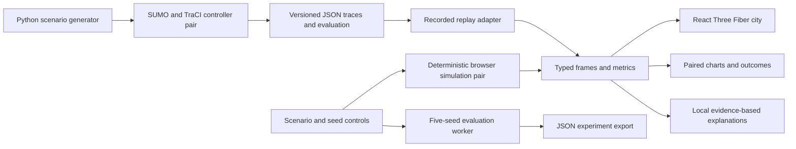

# Simulation methodology and evaluation

## Scope and hypotheses

Test whether a simple, explainable adaptive signal controller reduces waiting relative to an equal-split fixed-time controller under synthetic demand. Both strategies receive identical scheduled arrivals, routes, incident timing and network geometry. No traffic data has been measured in Bengaluru. Junction names are illustrative.

This is a controller comparison within each model, not validation of the models against reality. The fixed baseline is deliberately simple (30-second equal green splits), not an optimized time-of-day plan. Improvements against this baseline do not establish superiority over optimized fixed signals, coordinated corridors or deployed adaptive systems.

## Network and demand

Four junctions at (±45, ±45) meters with eight external approaches ending at ±110 m. Each road has one lane per direction. Vehicles travel straight across two junctions; there are no turns or lane changes. The browser also supports a single junction. SUMO uses left-hand traffic, 4.2 m cars, 2.5 m minimum gaps, 10 m/s maximum speed, 2.6 m/s² acceleration, 4.5 m/s² deceleration, a 1 s headway and zero driver imperfection (`sigma=0`).

Per-entry arrival rates:

| Scenario | East/west | North/south | Incident |
|---|---:|---:|---|
| Normal | 0.075 veh/s | 0.075 veh/s | None |
| Rush | 0.22 veh/s | 0.055 veh/s | None |
| Incident | 0.22 veh/s | 0.055 veh/s | First west entry, 90–180 s |

Each 0.5 s step independently generates an arrival with probability rate × step. This is a Bernoulli approximation, not calibrated demand. Arrivals stop at 300 s, followed by a 300 s clearance period. Trips still pending at the 600 s horizon remain in the reported cohort.

The browser uses a 32-bit linear congruential generator. SUMO route generation uses Python's seeded random generator. SUMO stochastic simulation parameters and seed are identical within pairs. Engine results are separate because their arrival schedules and physical dynamics differ. Browser seed controls and demand sliders do not recalculate SUMO traces.

The incident is a hard stop barrier 22 m before junction 01 in the browser, and a 0.1 m/s speed limit on SUMO's incoming `W0_J0_0` lane. This difference is intentional and disclosed; it prevents treating results across engines as interchangeable.

## Controllers

Each junction independently alternates east/west and north/south greens. There are no turning conflicts in this network.

- **Fixed:** 30 s green per axis, then 3 s amber and 3 s all-red.
- **Adaptive:** 10 s minimum green; 42 s maximum green. Between those limits, switch when the other axis's pressure exceeds the current axis by more than 1, or its oldest approaching vehicle has accumulated at least 55 s waiting.
- **Pressure:** number of approaching vehicles within 65 m + greatest accumulated wait among those vehicles / 12.
- Switching always passes through amber and all-red before the conflicting axis turns green. Green caps force phase alternation even when the dominant stream remains busy.

The 55 s age condition refers to **accumulated vehicle waiting**, possibly including an upstream junction, not strictly red time at the current light. These safeguards prevent phase monopolization; they cannot guarantee bounded individual waits with excessive arrival demand or blocked downstream roads. No claim of formal road-safety certification is made.

## Metrics

At time t, the denominator is all vehicles whose scheduled departures have been released, including completed, active and not-yet-inserted vehicles. Vehicles scheduled in the future are excluded.

| Metric | Definition |
|---|---|
| Mean waiting | Total accumulated standstill time (speed < 0.1 m/s) plus departure/insertion delay, divided by released vehicles |
| Average delay | Browser: integral of 1 − speed/10 over each step, including pending time. SUMO: TraCI `getTimeLoss()` plus departure delay, accumulated for each released vehicle |
| Queue | Current number of stopped, inserted vehicles; pending insertion is exported separately |
| Mean queue | Time integral of the current network queue divided by the 600 s horizon |
| Throughput | Completed trips during the observation window, not an extrapolated hourly rate |
| Stops | Moving-to-stopped transitions after insertion; pending insertion alone does not count as a stop |
| Worst wait | Largest accumulated waiting time among all released vehicles |
| Approach wait equality | Jain's index `(sum means)^2 / (n * sum squared means)` over mean waits for populated directional approach groups (E/W/S/N) |
| Percentage reduction | `100 * (fixed − adaptive) / fixed`; undefined when fixed is zero |

Jain's index is 1 for equal group waits (and by convention for all zero); equal suffering is not good service. Always inspect mean and worst waiting alongside it. Grouping by direction across the network can hide differences between specific junctions. An arriving SUMO vehicle's final delay uses its last available TraCI sample; at 0.5 s resolution this can omit at most the final sampled segment's time loss. Waiting and stops are sampled at the same resolution. SUMO tripinfo XML is retained in generated local files for further analysis.

## Repeated experiments

Five evaluation seeds: **11, 22, 33, 44, 55**. Seed 42 is reserved for visual replay and is excluded from the five-seed estimate. For each seed calculate the paired percentage change in mean waiting. Report its mean and a two-sided Student t interval using df=4, t=2.776. This is an exploratory interval across five synthetic demand seeds; it does not quantify real-world uncertainty or model misspecification.

The JSON evidence contains individual runs, cohort counts, all headline metrics, mean queues, route-file SHA-256, collisions and teleports. Both controllers read the same route file. Reproduce with the pinned SUMO 1.28.0 dependencies and `python simulation/evaluate.py`.

## Verified results

| Engine | Scenario | Mean waiting reduction | 95% t interval |
|---|---|---:|---:|
| Browser v1 | Normal | 21.22% | 15.63–26.80% |
| Browser v1 | Rush | 25.60% | 20.89–30.32% |
| Browser v1 | Incident | 32.56% | 25.68–39.45% |
| SUMO 1.28.0 | Normal | 35.06% | 21.87–48.25% |
| SUMO 1.28.0 | Rush | 50.00% | 45.75–54.25% |
| SUMO 1.28.0 | Incident | 48.59% | 42.38–54.81% |

These are means of paired percentage reductions, not percentages derived from pooled vehicle data. SUMO's 30 evaluation runs (15 matched pairs) finished all released trips by 600 s. All 36 runs including replay generation had zero reported colliding vehicles and zero teleports. Negative results are preserved if future configurations produce regressions.

## Architecture

The application runs entirely on static hosting. No server accepts credentials or controls traffic. Scene geometry is generated locally, static buildings are merged to reduce draw calls, and vehicles use GPU instancing. The Web Worker isolates repeated browser experiments from the UI thread. There is no external model call hidden behind the assistant.

## Sources

- [Eclipse SUMO downloads and Python packages](https://sumo.dlr.de/docs/Downloads.php)
- [TraCI Python interface](https://sumo.dlr.de/docs/TraCI/Interfacing_TraCI_from_Python.html)
- [SUMO traffic-light control](https://sumo.dlr.de/docs/Simulation/Traffic_Lights.html)

## Next validation steps

Add turning conflicts and pedestrians before proposing more realistic junction logic; calibrate a licensed GIS network and independently collected traffic counts; add vehicle classes; benchmark against optimized fixed-time and coordinated controllers; use more seeds and demand patterns; validate on physical low-end phones and multiple browser engines. None of these are implied by the present results.
